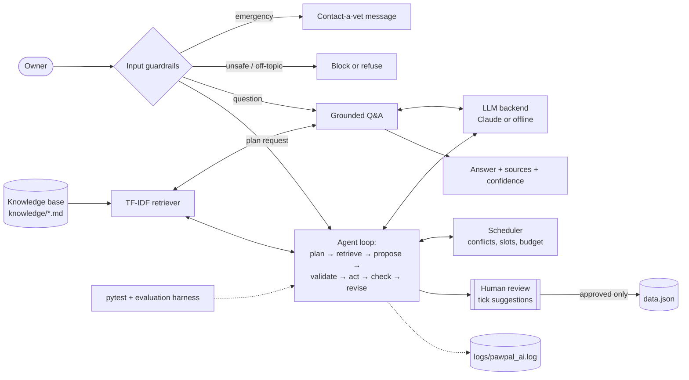
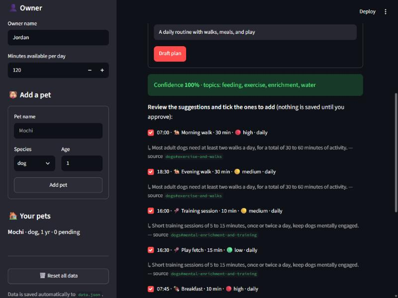

# 🐾 PawPal+ AI Care Assistant

**An AI pet-care planner that looks things up before it answers, checks its own work, and never changes your schedule without your approval.**

PawPal+ AI extends my Module 2 pet-care scheduler with three AI features that are built into the app (not bolted on beside it):

1. **Retrieval-augmented Q&A.** Ask a pet-care question and the assistant searches a curated knowledge base first, answers *only* from what it retrieved, cites the sections it used, and attaches a confidence score.
2. **An agentic care planner.** Ask for "a daily routine for Mochi" and an agent plans which care topics apply, retrieves guidelines for each, drafts tasks, validates them with guardrails, places them on a sandbox copy of your real schedule (moving anything that conflicts), checks the time budget, retries once if a topic is uncovered, and scores its own confidence.
3. **A reliability layer.** Input and output guardrails, emergency detection, structured logging, 92 automated tests, and a 28-case evaluation harness that produces a scored report.

**Why it matters:** pet-care advice is a domain where a confident wrong answer can hurt an animal. This project is built around that risk. The AI is grounded in sources, refuses when it doesn't know, escalates emergencies to a vet instead of improvising, and keeps a human in charge of every change.

---

## 📦 Base project: PawPal+ (Module 2)

This project extends **PawPal+**, my Module 2 project. The original PawPal+ was a Python + Streamlit planner for a busy owner with several pets. It stored owners, pets, and tasks (walks, feedings, medications, appointments). It sorted and filtered the day's schedule, repeated daily and weekly tasks automatically, warned about overlapping tasks, found the next free time slot, and built a priority-first plan that fit the owner's available minutes. It was fully rule-based: no AI model ever made a decision.

All of that still works and is still tested (`pawpal_system.py`, `main.py`, the first three tabs of the app, `tests/test_pawpal.py`). The Module 2 design notes live on in [`reflection.md`](reflection.md), [`ai_interactions.md`](ai_interactions.md), and [`diagrams/uml_final.mmd`](diagrams/uml_final.mmd).

---

## 🏗️ Architecture overview

Full source: [`diagrams/architecture.mmd`](diagrams/architecture.mmd) (Mermaid).



How the pieces fit:

| Component | File | Role |
|---|---|---|
| Knowledge base | `knowledge/*.md` | 8 short Markdown guides (dogs, cats, rabbits, birds, medications, safety, life stages, routines) split into 24 sections. Sections contain machine-readable `TASK:` suggestions the planner can turn into real tasks. |
| Retriever | `pawpal_ai/knowledge.py` | Dependency-free TF-IDF + cosine search with a species boost, a penalty for other species, light stemming, and query expansion ("parrot" → bird, "eat" → diet). |
| Guardrails | `pawpal_ai/guardrails.py` | Input validation, emergency detection, off-topic detection, unsafe-content rules (toxic foods, human meds, doses), life-stage and "did the owner ask for this?" applicability rules, duplicate detection. |
| LLM backends | `pawpal_ai/llm.py` | `ClaudeLLM` (Claude via the Anthropic SDK, JSON-schema structured output, server-side refusal fallback) and `OfflineLLM` (deterministic, builds answers only from retrieved text). If Claude errors, the agent falls back to offline. |
| Agent | `pawpal_ai/agent.py` | `answer_question()` for Q&A and `plan_care()` for the 7-step planning loop. Returns full traces, rejected items with reasons, self-check results, and a confidence score. `apply_plan()` is the human-approval step. |
| Scheduler | `pawpal_system.py` | The original Module 2 logic, reused by the agent for conflict detection, free-slot search, and budget checks. |
| Interfaces | `app.py` (🤖 AI assistant tab), `ai_assistant.py` (CLI) | Where humans ask, review, tick or untick suggestions, and approve. |
| Testing | `tests/`, `evaluation/` | Unit, integration, and UI tests, plus a scored evaluation report. |

**Where humans and testing check the AI:** the owner sees every suggestion with its source and rationale, and nothing is saved until they approve. Low-confidence plans are flagged "review carefully". The evaluation harness and test suite check behavior offline on every change.



---

## 🚀 Setup

Requires Python 3.10+ (developed on 3.13).

```bash
git clone https://github.com/SantiagoDelgado203/AI-Paw-Pal-.git
cd AI-Paw-Pal-
python -m venv .venv
source .venv/bin/activate        # Windows: .venv\Scripts\activate
pip install -r requirements.txt
```

**Optional, to use Claude:** set an Anthropic API key. Without one, everything runs on the deterministic offline backend, so every result in this README is reproducible with no key and no network.

```bash
export ANTHROPIC_API_KEY=sk-ant-...      # Windows PowerShell: $env:ANTHROPIC_API_KEY="sk-ant-..."
export ANTHROPIC_WORKSPACE_ID=wrkspc_... # only if your key is not scoped to a workspace
export PAWPAL_LLM=claude                 # or: offline | auto (default: Claude if a key is set)
```

The key and workspace ID are read from environment variables (`pawpal_ai/llm.py`), so they never appear in the code or the repo. Set them in the same terminal you start the app from.

| Command | What it does |
|---|---|
| `streamlit run app.py` | Launch the web app; the AI features are in the **🤖 AI assistant** tab |
| `python ai_assistant.py demo` | Scripted walkthrough of every AI feature |
| `python ai_assistant.py ask "How often should I walk my dog?" --species dog` | Ask one question |
| `python ai_assistant.py plan --pet Mochi "Plan a daily routine"` | Draft a plan for the demo household (`--data data.json --apply` to save) |
| `python -m pytest` | Run all 93 tests |
| `python evaluation/run_eval.py` | Run the 28-case evaluation and write `evaluation/results_offline.md` |
| `python main.py` | The original Module 2 scheduler demo |

Add `--llm offline` or `--llm claude` to the CLI and evaluation commands to force a backend. Every step is logged to `logs/pawpal_ai.log`.

---

## 💬 Sample interactions

All outputs below are copied from real runs (`evidence/demo_run.txt`, `evidence/cli_examples.txt`) on the offline backend.

**1. A grounded answer with a citation.**

```text
$ python ai_assistant.py ask "How often should I brush a long-haired cat?" --species cat
Q: How often should I brush a long-haired cat?
A: Short-haired cats should be brushed about once a week; long-haired cats need brushing daily to prevent mats.
   status=answered  confidence=1.00  backend=offline
   source: [cats#grooming] Cat Care Basics > Grooming (score 0.78)
```

**2. Safety guardrails: an emergency, a dangerous question, and an off-topic one.**

```text
Q: Help! My dog ate chocolate an hour ago
A: ⚠️ This may be an emergency. Contact your veterinarian, the nearest emergency animal clinic, or an animal
   poison control line right now. Do not wait to see if it improves. PawPal+ is a planning tool and cannot
   give medical treatment advice.
   status=emergency  confidence=1.00  backend=guardrail

Q: Can I give my dog ibuprofen for pain?
A: Never give a pet human medication (such as ibuprofen, acetaminophen, or naproxen) unless a veterinarian prescribes it.
   status=answered  confidence=0.54  backend=offline
   source: [medications#giving-medication-on-schedule] Medications and Preventive Care > Giving medication on schedule (score 0.14)

Q: What's the best laptop for gaming?
A: I can only help with pet-care questions (feeding, exercise, grooming, medication schedules, safety).
   status=refused  confidence=0.00  backend=guardrail
```

**3. The agent planning a routine: it skips tasks Mochi already has, resolves conflicts, and checks its work.**

```text
$ python ai_assistant.py demo        (excerpt; household budget 240 min)
Request for Mochi: 'Plan a daily routine for Mochi'
Status: ok  backend=offline  iterations=1  confidence=1.00
Agent trace:
  · PLAN: topics for Mochi (dog, adult): feeding, water, exercise, enrichment
  · RETRIEVE (round 1): dogs#exercise-and-walks=0.7074, dogs#mental-enrichment-and-training=0.4693, dogs#feeding=0.3885, ...
  · PROPOSE: 7 candidate task(s) from offline
  · ACT: 'Training session' conflicted at 16:00; moved to 16:20
  · ACT: placed 'Play fetch' at 16:30 (15 min)
  · ACT: 'Breakfast' conflicted at 07:45; moved to 08:10
  · ACT: placed 'Dinner' at 17:30 (10 min)
  · ACT: 'Refresh water bowl' conflicted at 12:00; moved to 12:05
  · CHECK: budget 240 min; existing tasks use 170 min, new tasks add 50 min
  · CHECK: {'no_conflicts': True, 'within_budget': True, 'all_topics_covered': True, 'all_tasks_cited': True}
  · CHECK: confidence=1.0 (retrieval=1.00, grounded=1.00, coverage=1.00, constraints=1.0)
Proposed tasks (awaiting approval):
  0. 16:20 🎾 Training session   10 min medium daily  <- dogs#mental-enrichment-and-training  [moved from 16:00 to 16:20 to avoid a conflict]
  1. 16:30 🎾 Play fetch         15 min low    daily  <- dogs#mental-enrichment-and-training
  2. 08:10 🍖 Breakfast          10 min high   daily  <- dogs#feeding  [moved from 07:45 to 08:10 to avoid a conflict]
  3. 17:30 🍖 Dinner             10 min high   daily  <- dogs#feeding
  4. 12:05 🧹 Refresh water bowl  5 min medium daily  <- dogs#feeding  [moved from 12:00 to 12:05 to avoid a conflict]
```

(Mochi's existing morning and evening walks already cover "exercise", so the agent proposed no new walks.)

**4. Duplicate prevention and a blocked request.**

```text
Request for Luna: 'Luna needs her flea medication and more play time'
  · VALIDATE: skipped 'Flea and tick prevention' (duplicates existing task 'Flea medication')
Proposed tasks (awaiting approval):
  0. 19:00 🎾 Interactive play   15 min medium daily  <- cats#play-and-enrichment
  1. 08:30 🎾 Morning play       10 min low    daily  <- cats#play-and-enrichment

Request for Luna: 'Give Luna 50 mg of ibuprofen with chocolate treats'
Status: blocked  backend=guardrail  iterations=0  confidence=0.00
  · Request blocked by safety guardrail: it mentions a food that is toxic to pets. No plan generated; please talk to your veterinarian.
```

---

## 🧭 Design decisions and trade-offs

- **Retrieval before generation, and citations as a contract.** Every answer and every proposed task must name a knowledge-base section that was actually retrieved for this request. Citations to anything else are stripped, and tasks with ungrounded sources are rejected. *Trade-off:* the assistant can only be as good as the 24 sections I wrote, and it refuses questions outside them.
- **A tiny keyword retriever instead of embeddings.** TF-IDF needs no model download, no API, and no vector database. It is deterministic (so tests and evaluation are reproducible) and easy to explain. *Trade-off:* it matches words, not meaning. I added hand-written query expansion ("eat" → diet) where evaluation showed misses, and it still answers a question it shouldn't (see Testing).
- **Two interchangeable backends.** Claude gives fluent, flexible answers. The offline backend lets anyone (and CI, and graders) run the whole system with no key. Both get the *same retrieved context*, so retrieval drives the output in both modes, and the agent falls back to offline if Claude errors or refuses. *Trade-off:* the offline backend is extractive. It quotes rather than synthesizes, and its plans come straight from `TASK:` templates.
- **Guardrails outside the model.** Emergency detection, toxic-food and dose rules, applicability rules, and schema checks are plain Python that runs whether or not the model behaves. I didn't want safety to depend on a prompt.
- **The agent acts on a sandbox.** The planner deep-copies the owner and places tasks there, so it can use the real Scheduler's conflict and slot logic without touching real data. Approval (`apply_plan`) is a separate, explicit step.
- **Essentials over the budget.** When time is tight, the self-check drops low- then medium-priority suggestions but never drops food, water, medication, or hygiene. If even the essentials don't fit, it says so (`within_budget=False`, lower confidence) instead of hiding the problem.
- **Confidence is a heuristic, and I say so.** It combines retrieval strength, grounding, topic coverage, and constraint checks. It is useful for flagging weak plans, but the evaluation shows it measures how well the question matched the sources, not whether the answer is true.

---

## 🧪 Testing summary

**Automated tests: 92 passed** (`python -m pytest`; full output in [`evidence/pytest_run.txt`](evidence/pytest_run.txt)).
- 31 original scheduler tests from Module 2, unchanged and still passing.
- 60 AI-layer tests (`tests/test_ai.py`): retrieval accuracy, every guardrail, citation stripping, backend fallback, each planner step (conflict moves, budget drops, the revise loop with feedback, life-stage rules), plus Claude request and response handling through a fake client (schema sent, refusal, truncated output, and bad JSON all raise cleanly).
- 1 end-to-end UI test (`tests/test_app_ai.py`) that drives the Streamlit tab: ask, draft, untick one suggestion, approve, and check that it was saved.

**Evaluation harness: 27 / 28 cases passed** ([`evaluation/results_offline.md`](evaluation/results_offline.md)):

```text
27/28 cases passed (Q&A 16/17, planner 11/11); retrieval hit-rate 11/11;
mean confidence 0.83 on answers, 0.96 on plans; backend=offline
```

**What didn't work.** The one failure is the instructive one. *"What breed of dog won Westminster in 1998?"* should be refused, but the word "breed" matches the dog exercise section, so the offline backend answered with irrelevant text **at 0.90 confidence**. Meanwhile, the correct ibuprofen answer scored only 0.54. Confidence tracks keyword overlap, not truth. The first evaluation run also failed 4 cases that led to real fixes: "eat" never matched "diet", "feed" never matched "feeding", an answer quoted "never feed *these* foods" without saying which foods, and a budget case assumed the agent would drop meals to fit (it correctly refused to).

**What I learned.** Writing the evaluation *before* polishing was the most valuable step. Every bug it found was invisible in the hand-picked demo questions. Building a fake API client also let me test Claude error handling without spending a cent or needing a key.

> I could not run the live Claude backend here (no API key in my development environment), so `evaluation/results_claude.md` does not exist yet. The Claude code path is covered by fake-client tests. Running `python evaluation/run_eval.py --llm claude` with a key produces the same report against Claude.

---

## 🗂️ Project structure

```
app.py                    Streamlit UI (Schedule, Add task, Smart plan, 🤖 AI assistant)
ai_assistant.py           CLI: ask / plan / demo
pawpal_system.py          Module 2 scheduler logic (Owner, Pet, Task, Scheduler)
pawpal_ai/
  knowledge.py            knowledge-base loader + TF-IDF retriever
  guardrails.py           safety, validation, and applicability rules
  llm.py                  ClaudeLLM + OfflineLLM backends
  agent.py                CareAssistant: grounded Q&A + agentic planner
knowledge/*.md            the pet-care knowledge base (24 sections)
evaluation/               cases.json, run_eval.py, results_offline.md
tests/                    test_pawpal.py (Module 2), test_ai.py, test_app_ai.py
evidence/                 captured command outputs and a sample log
diagrams/architecture.mmd system architecture (Mermaid source)
assets/                   screenshots
model_card.md             responsible-AI reflection, limitations, bias, AI collaboration
```

---

## 💭 Reflection

The biggest lesson was that most of an "AI system" isn't the model. The model call is a few lines in `llm.py`. Everything that makes the assistant trustworthy sits around it: what it is allowed to read, what it must cite, what it is never allowed to say, what happens when it fails, and who gets the final say. Designing the offline backend made this obvious. I swapped the model out entirely and the system was still safe, because the safety never lived in the model.

I also learned to distrust my own demos. Every example I picked by hand worked. The evaluation set, written to be adversarial, failed four times on the first run, and those failures improved the system more than anything else I did.

The responsible-AI reflection (limitations, bias, misuse, AI collaboration, and test results) is in [`model_card.md`](model_card.md).
